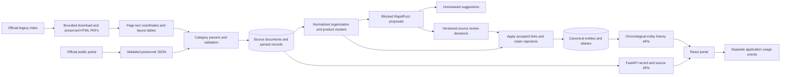
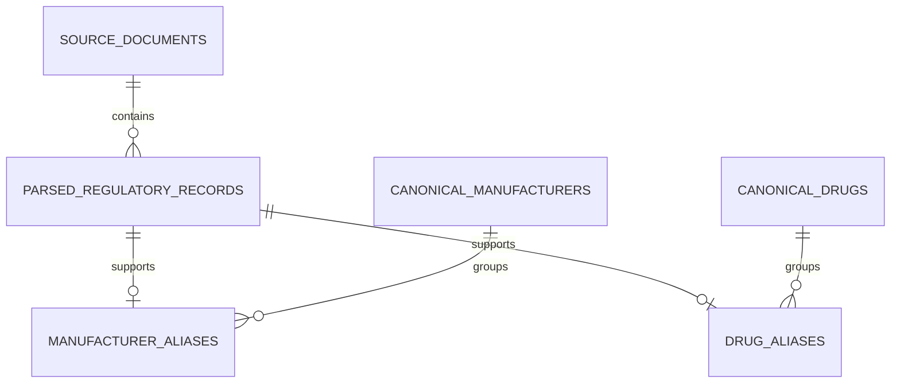

# Final architecture and workflow

Updated 19 October 2026. Solid schema relationships below correspond to implemented foreign keys. Match and usage references are logical keys only.

## Processing architecture

The live SQLite demo has 599 source rows. PostgreSQL uses the same SQLAlchemy models but execution remains untested. RapidFuzz proposals alone never create a reviewed identity.

## Implemented relational schema

entity_matches stores string comparison keys and evidence JSON. It has no foreign key to canonical entities. ingestion_runs is a process log without a run-to-source association table. web_usage_events stores logical entity type/ID references rather than enforced entity foreign keys.

## Temporal and batch semantics

Histories join aliases to records and sources, then sort by date, document, serial and record ID. Portal date precision is month. Organization histories aggregate names while preserving observed manufacturing addresses. Batch contexts use product, organization and observed address; no globally unique batch table is asserted.

The old temporal helper files are not on the production path. Revision linking remains absent unless future evidence supports an explicit relation.
